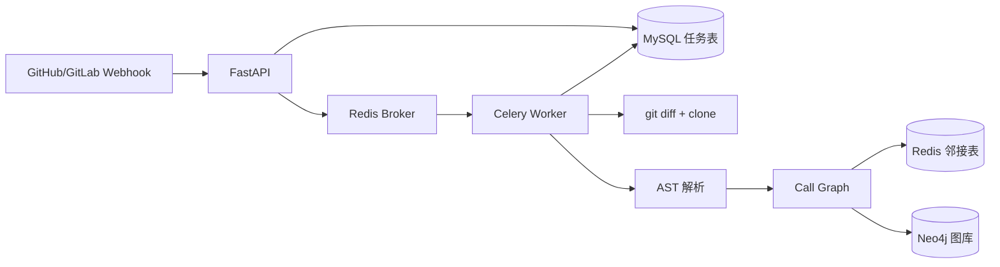

# DiffGate

基于 **AST 逆向接口追溯** 引擎，技术栈 **FastAPI + Celery + Redis + MySQL + Neo4j**（四步流水线见 [docs/AST_REVERSE_TRACE.md](docs/AST_REVERSE_TRACE.md)）：监听 GitHub / GitLab Webhook，在 MR/PR 或 Push 时通过 `git diff` 定位变更行，用 Python `ast` 构建 **方法 → 服务 → Controller/API** 反向调用图，输出受影响的接口列表。

## 架构



## 快速开始

1. 启动依赖：

```bash
docker compose up -d
```

2. 安装并配置环境：

```bash
python -m venv .venv
.venv\Scripts\activate
pip install -r requirements.txt
copy .env.example .env
```

3. 初始化后启动 API、前端；**默认 `USE_BACKGROUND_TASKS=true`**，分析任务在 API 进程后台线程执行，**无需 Redis / Celery Worker**：

```powershell
.\scripts\run_api.ps1
.\scripts\run_web.ps1
```

多实例或生产队列：在 `.env` 设置 `USE_BACKGROUND_TASKS=false`，并另开 Worker：

```powershell
.\scripts\run_worker.ps1
```

前端：**Vue 3 + Vite + TypeScript**，调用链可视化使用 **AntV G6**（与 React 方案共用同一图数据 API）。详见 [web/README.md](web/README.md)。

4. 配置 Webhook（指向本机或内网穿透地址）：

| 平台 | URL | 事件 |
|------|-----|------|
| GitHub | `POST /api/v1/webhooks/github` | Pull request、Push |
| GitLab | `POST /api/v1/webhooks/gitlab` | Merge request、Push |

查询任务结果：`GET /api/v1/jobs/{job_id}`

## 本地仓库分析（无 Webhook）

```bash
set PYTHONPATH=.
python -m scripts.analyze_local --repo D:\path\to\repo --base main --head feature/x
```

## 业务价值

修改公共工具类时，系统沿反向调用链聚合到 FastAPI `router.get/post/...` 装饰的路由，返回精确 API 列表（方法、路径、文件、行号）。

## 扩展

- **Java**：在 `app/parsers/` 增加 JavaParser 适配，写入同一 `CallGraph` / Neo4j 模型。
- **tree-sitter**：大仓库可替换 `python_ast.py` 为 tree-sitter 以提升速度。
- 生产环境请配置 `WEBHOOK_SECRET_*`、私有仓库凭据与 Worker 并发数。

## 环境变量

见 [.env.example](.env.example)。`USE_NEO4J=false` 时仅使用 Redis 邻接表 + MySQL 结果存储。