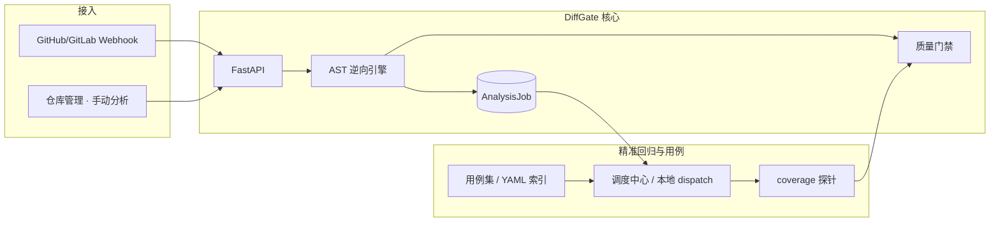

# DiffGate 产品说明书

> **Code Change Intelligence**：基于 AST 逆向接口追溯与质量门禁的变更影响分析与精准回归平台。  
> **适用读者**：研发负责人、测试/质量工程师、平台运维、CI 集成开发。  
> **界面版本**：Web v1.0（Vue 3 + Material Design 3） · **文档版本**：2026-11 · 与当前仓库功能对齐。  
> **说明**：本文纯文字描述，不含界面截图。

---

## 1. 产品定位与价值

DiffGate 在代码 **Push / Merge Request** 后自动完成：

| 阶段 | 能力 |
|------|------|
| 变更定位 | `git diff` 提取变更行、文件与符号 |
| 影响分析 | AST 构建调用图，反向追溯到 Web API（如 FastAPI 路由） |
| 精准回归 | 按影响面收敛待测 API 与关联用例集 |
| 探针覆盖率 | 冒烟/测试执行 + `coverage` 统计 **增量行覆盖率** |
| 质量门禁 | 覆盖率阈值、高危路径/符号、回归结果 → **PASS / BLOCK / PENDING / OVERRIDDEN** |

**重要约定**：平台内「已拦截」是 **DiffGate 裁决结果**，**不会自动阻断 Git Push**；若要在 CI 中 fail job，需自行读取 `gate_result` 或调用门禁 API 后决定退出码。

---

## 2. 系统架构（逻辑）



- **开发默认**：`USE_BACKGROUND_TASKS=true` 时，分析在 API 进程后台线程执行，可无需 Celery Worker。  
- **可选依赖**：Redis/Celery 队列、Neo4j 图库、MySQL 或本地 SQLite（`data/diffgate.db`）。

---

## 3. 角色、登录与全局能力

### 3.1 访问控制

- 除 **登录页**（`/login`）外，所有路由需有效会话；未登录访问将跳转登录并带上 `redirect` 回跳。
- **登录方式**（依部署配置）：
  - **Personal Access Token**：GitHub / GitLab（含自定义 GitLab Base URL）；
  - **账号密码**：平台本地账号；
  - **本地开发**：本机可一键「本地调试登录」（仅 localhost 场景）。
- 首次密码登录可引导 **设置平台密码**。
- **管理员**（`role=admin`）可在顶栏用户菜单打开 **成员管理**：查看成员、调整角色。

### 3.2 顶栏与全局操作

| 元素 | 说明 |
|------|------|
| 主导航 | 质量驾驶舱、变更影响、精准回归、仓库管理、用例集管理 |
| 环境状态 | 展示 Staging 与引擎/数据库连接摘要；异常时可查看服务状态面板 |
| **+ 新建分析** | 弹窗选择已接入仓库、分支，触发一次变更分析任务 |
| **Webhook 帮助** | 侧滑说明 GitHub/GitLab Webhook URL 与事件配置 |
| 用户菜单 | 成员管理（管理员）、退出登录 |

---

## 4. Web 功能模块总览

| 导航 | 路径 | 功能摘要 |
|------|------|----------|
| 质量驾驶舱 | `/dashboard` | 覆盖率与门禁 KPI、趋势、拦截原因、热点文件、最近门禁流水 |
| 变更影响 | `/analysis` | 分析任务列表、筛选、分页；进入作业详情 |
| 精准回归 | `/regression` | 回归批次、用例结果、增量覆盖率探针、人工豁免 |
| 仓库管理 | `/repositories` | 列表/KPI、接入与编辑、索引、Webhook、触发分析、门禁阈值 |
| 用例集管理 | `/test-suites` | 用例集 CRUD、同步索引、供仓库关联 |
| 添加/编辑仓库 | `/repositories/new` · `/repositories/:id/edit` | 全页表单（新建为 MD3 深色风格，编辑为 Outlined） |
| 添加/编辑用例集 | `/test-suites/new` · `/test-suites/:id/edit` | 全页表单（新建为 MD3） |
| 作业详情 | `/jobs/:id` | 调用链拓扑、变更函数、Code Diff、跳转回归 |

---

## 5. 质量驾驶舱（`/dashboard`）

面向管理视角的 **质量与门禁大盘**。

### 5.1 核心 KPI（示例）

- 平均增量代码覆盖率（无回传时标注「暂无覆盖率」，不伪造 0%）
- 质量门禁一次通过率
- 累计高危变更拦截次数
- 精准测试累计节省工时 / 用例压缩率等聚合指标

### 5.2 图表与列表

- **增量覆盖率 vs 门禁通过趋势**：变更行数柱 + 覆盖率折线；无数据日断开。
- **门禁拦截原因分布**：仅统计 `BLOCK` 的原因标签（如增量覆盖率不足、高危未评审等）。
- **变更热点**：高频变更文件/路径，可联想至关联分析作业。
- **最近质量门禁动态**：仓库、Commit、变更规模、覆盖率、状态（通过 / 待处理 / 已拦截 / 人工豁免）。

### 5.3 交互

- 支持时间范围、仓库等筛选（依实现加载 `/dashboard/overview`）。
- 刷新拉取最新聚合数据。

---

## 6. 变更影响（`/analysis`）

分析任务 **AnalysisJob** 的列表与入口。

### 6.1 列表能力

- 按 **仓库**、**作业状态**（全部 / 已完成 / 分析中 / 排队 / 失败）筛选。
- 展示执行状态、门禁徽标、耗时、变更规模等。
- 分页（每页 10/25/50）。
- 点击行进入 **作业详情**（`/jobs/:id`）。

### 6.2 任务来源

- GitHub / GitLab **Webhook**（Push、MR/PR）。
- 仓库管理页 **触发分析**。
- 顶栏 **新建分析**（选仓库与分支）。
- 命令行 `scripts/analyze_local.py`（无 Webhook 本地对比分支）。

### 6.3 作业详情（`/jobs/:id`）

| 区块 | 说明 |
|------|------|
| 影响拓扑图 | AntV G6：节点/边来自 `GET /jobs/{id}/graph`；支持按文件聚合、路径高亮 |
| 变更函数明细 | 搜索、过滤、查看嫌疑函数与层数（调用深度） |
| Code Diff | 抽屉展示变更片段与风险调用点（`GET /jobs/{id}/code-diff`） |
| 作业元数据 | 仓库、分支、Commit、状态、门禁结果、错误信息人性化展示 |
| 跳转 | 可进入精准回归对应批次（若已产生） |

分析完成后，若配置 `DISPATCH_CENTER_URL`，可推送调度中心；初始 `gate_result` 在无覆盖率时常为 **PENDING**。

---

## 7. 精准回归（`/regression`）

将 **影响 API** 与 **用例集**、**覆盖率探针** 关联为可审计的回归批次。

### 7.1 布局

- **左栏 · 回归执行批次**：仓库、分支、Commit、时间、API 数量、覆盖率、门禁徽标（含豁免）。
- **右栏 · 批次详情**：
  - **受影响 API 用例**：YAML/用例行、断言摘要、展开请求/响应；
  - **增量覆盖率**：变更行探针列表（覆盖/未覆盖/上下文），汇总百分比。

### 7.2 KPI 联动

累计精准用例、通过率、探针覆盖率、当前选中批次的门禁状态随选中项更新。

### 7.3 人工豁免

- **条件**：当前批次 `gate=BLOCK`。
- **入口**：详情区「人工豁免放行」。
- **必填**：原因分类（Hotfix / 无法模拟分支 / 已评审非核心 / 其他）+ 说明（≥2 字）+ 操作人身份。
- **结果**：`gate=OVERRIDDEN`，审计字段保留；已豁免批次再次跑 coverage 时 **不会自动改回 BLOCK**。
- **API**：`POST /api/v1/regression/batches/{job_id}/override`

### 7.4 探针重跑

- 可对批次触发覆盖率探针重算：`POST /api/v1/regression/batches/{id}/run-coverage`  
- 或本地脚本 `scripts/coverage.py --job-id <uuid>`。

---

## 8. 仓库管理（`/repositories`）

### 8.1 列表页

- 搜索、分页、启用/禁用开关。
- KPI 卡：已接入仓库数、分析次数、高危拦截估算、回归省时比例等。
- 行操作：编辑、删除、触发分析、重建 AST 索引等（依权限与状态）。

### 8.2 添加仓库（`/repositories/new`）

全页 **MD3 深色 840px** 表单，分三张卡片：

**（1）基本信息**

- 来源（GitLab / GitHub / 本地）、认证方式。
- 默认分支、仓库名称、Clone URL（支持粘贴探测）；可选描述。
- 填写 Clone URL 后可 **自动探测** 仓库类型与建议扫描根目录。

**（2）扫描与联动**

- **仓库类型**：自动识别或手动指定（Python / 前端 / Node / Go / Java 等）。
- **重新探测**：依赖已填 Clone URL；识别成功显示绿色提示。
- **源码根目录**、**关联用例集**（来自用例集管理）、**关联上下游仓库**（多选）。
- Monorepo 提示：可选 **同时创建前后端两条仓库** 并建立联动。

**（3）高级配置**（可折叠）

- **门禁阈值**：增量覆盖率滑块与数值、高危 API 数量阈值、高危符号数量阈值。
- **高危/低危路径**：glob 黑名单（禁止合入）、白名单（忽略计数）；每行一条规则。
- **IM 门禁通知**：Webhook URL（支持测试消息）、通知策略（仅 BLOCK / 始终等）。

**底栏固定操作**

- 开关：**启用分析**、**接收 Webhook**、**允许提交人自审豁免**。
- **取消** / **保存并初始化索引**（保存后触发 AST 全量索引）。

### 8.3 编辑仓库（`/repositories/:id/edit`）

与新建能力等价，采用 **Outlined 全页** 样式（非 MD3 新建皮肤）；数据结构一致。

### 8.4 仓库级门禁与通知字段（摘要）

| 配置项 | 作用 |
|--------|------|
| `coverage_threshold` | 增量覆盖率门禁基线（默认 80%） |
| `high_risk_paths` / `low_risk_paths` | glob 规则命中驱动拦截或豁免计数 |
| `high_risk_api_threshold` / `high_risk_symbol_threshold` | 影响面过大时标记高危 |
| `notify_webhook_url` + `notify_policy` | 门禁结果推送飞书/钉钉/企业微信机器人 |
| `webhook_enabled` | 是否接收 Git 平台 Webhook |
| `allow_self_override` | 是否允许提交人在平台内自审豁免（策略项） |
| `scan_root` | AST 扫描根（如 `app`、`src/main/java`） |
| `test_suite_id` | 默认关联用例集，供回归收敛 |

### 8.5 索引与探测 API（平台侧）

- **仓库类型探测**：根据 Clone URL、凭据识别技术栈与推荐 `scan_root`。
- **分支列表**：添加/编辑时可拉取远程分支。
- **重建索引**：更新 `last_indexed_at`，刷新调用图基线。
- **测试通知**：向 IM Webhook 发送探测消息。

---

## 9. 用例集管理（`/test-suites`）

登记 **API 自动化用例集**，供仓库「关联用例集」与精准回归调度使用。

### 9.1 列表页

- 搜索、展示标识（slug）、框架类型、索引/用例统计、启用状态。
- **新建用例集** → `/test-suites/new`；行内编辑、删除、**同步**（重新扫描用例索引）。

### 9.2 添加用例集（`/test-suites/new`）

**基础信息**

- 名称、标识（slug）、描述；**立即启用**开关。
- **关联业务仓库**（可选）：与 DiffGate 已接入仓库建立绑定。

**用例来源与同步方式**（三选一）

| 模式 | 说明 |
|------|------|
| **Git 测试仓库（推荐）** | 独立测试仓或 **复用业务仓库**；配置 URL/分支/扫描目录、框架类型、凭证与 SSL 选项；支持 **拉取分支列表**、**测试连通性并预览用例数** |
| **外部 CI / Webhook** | 配置 **调度触发 Webhook URL**（精准回归时 POST `api_list` 与 `job_id`）、可选 **外部平台引用 ID**（如 Jenkins Job）；可 **发送测试 Ping** |
| **仅手工登记** | 不拉 Git/Webhook；创建后于变更影响或外部脚本维护用例与覆盖率 |

**Git 模式要点**

- 代码库位置：独立仓库 / 复用业务仓库。
- 目标分支：支持下拉缓存 + **手工输入**（ComboBox）；右侧刷新依赖已填仓库地址。
- 用例扫描目录：如 `cases/`。
- 测试框架：pytest、httprunner、YAML、JUnit、Go test 等（依后端预设）。
- 高级凭证：平台继承登录、Token、SSH；可跳过自签名 SSL。

**高级配置**（可折叠，与仓库类似）

- 门禁相关阈值、路径规则、通知 Webhook 等（与仓库高级块能力对齐）。

**底栏**：取消 / **创建用例集**。

### 9.3 编辑用例集

路径 `/test-suites/:id/edit`；字段与新建一致，Outlined 编辑态。

### 9.4 与精准回归的关系

- 分析作业产出 `affected_apis` 后，调度层根据仓库关联的用例集 **收敛** 待执行用例。
- 用例集 **同步** 更新本地索引，保证 YAML/用例清单与 Git 源一致。

---

## 10. 端到端业务流程

```text
1. 配置仓库（+ 可选用例集）→ 保存并 AST 索引
      ↓
2. 研发 Push / MR → Webhook 或手动「新建分析」
      ↓
3. 创建 AnalysisJob → AST 分析（completed / failed）
      ↓
4. 写入 affected_apis、changed_symbols、gate_result（常 PENDING）
      ↓
5. notify_dispatch_center（可选）→ 外部 CI 或 POST /dispatch/regression
      ↓
6. 执行受影响用例 + coverage 探针 → POST /jobs/{id}/gate-report
      ↓
7. 更新 incremental_coverage_pct、coverage_probes → PASS / BLOCK
      ↓
8. 驾驶舱 / 精准回归展示；BLOCK 时可人工豁免 → OVERRIDDEN
```

### 10.1 本地探针（测试环境）

`.env` 示例：

```env
DISPATCH_CENTER_URL=http://127.0.0.1:8000/api/v1/dispatch/regression
API_PUBLIC_BASE_URL=http://127.0.0.1:8000
```

手动探针：

```powershell
$env:PYTHONPATH="."
.\.venv\Scripts\python.exe scripts\coverage.py --job-id <AnalysisJob UUID>
```

---

## 11. 质量门禁规则

结果存储于 `analysis_jobs.gate_result`（JSON）。

### 11.1 状态枚举

| 状态 | 含义 |
|------|------|
| **PENDING** | 有影响面，尚未回传覆盖率 |
| **PASS** | 满足阈值与规则 |
| **BLOCK** | 触发拦截原因 |
| **OVERRIDDEN** | 原 BLOCK 经人工豁免，保留审计 |

### 11.2 常见 block_reason

| 键 | 展示含义 |
|----|----------|
| incremental_coverage_low | 增量覆盖率低于仓库阈值 |
| core_api_regression | 核心接口回归失败 |
| analysis_failed | 分析任务失败 |
| high_risk_unreviewed | 高危 API/符号或路径规则触发 |
| pending_coverage | 等待覆盖率回传（说明用） |

**零影响变更**：无 API/符号/嫌疑时自动 **PASS**（`coverage_source: auto_zero_impact`）。

### 11.3 gate-report 回传示例

```json
{
  "incremental_coverage_pct": 88.6,
  "tests_passed": true,
  "coverage_probes": [
    { "file": "app/main.py", "line": 42, "covered": true, "prefix": "+" }
  ]
}
```

---

## 12. 探针增量覆盖率

- **计算**：变更 `line_ranges` 与测试执行命中行求交 → `incremental_coverage_pct` 与 `coverage_probes[]`。
- **展示**：精准回归 KPI、批次列表、详情 Tab。
- **注意**：覆盖率 BLOCK **不等于** 单条 API 用例 FAIL；用例状态以冒烟/模拟结果为准。

---

## 13. 平台 Webhook 接入（Git）

| 平台 | URL | 建议事件 |
|------|-----|----------|
| GitHub | `POST /api/v1/webhooks/github` | Pull request、Push |
| GitLab | `POST /api/v1/webhooks/gitlab` | Merge request、Push |

本机调试穿透见 [WEBHOOK_NGROK.md](./WEBHOOK_NGROK.md)。  
前端 **Webhook 帮助** 抽屉汇总 URL、Secret 与事件说明。

---

## 14. 主要 HTTP API（速查）

前缀：`/api/v1`

| 模块 | 方法 | 路径 | 说明 |
|------|------|------|------|
| 认证 | POST | `/auth/*` | 登录、会话、成员（依部署） |
| Webhook | POST | `/webhooks/github` `/webhooks/gitlab` | 接收 Push/MR |
| 作业 | GET | `/jobs` `/jobs/{id}` | 列表与详情 |
| 作业 | GET | `/jobs/{id}/graph` | G6 拓扑 |
| 作业 | GET | `/jobs/{id}/code-diff` | Diff 片段 |
| 作业 | POST | `/jobs/{id}/gate-report` | CI 回传覆盖率与测试 |
| 驾驶舱 | GET | `/dashboard/overview` | KPI + 趋势 + 流水 |
| 回归 | GET | `/regression/overview` `.../batches` `.../batches/{id}` | 精准回归 |
| 回归 | POST | `/regression/batches/{id}/override` | 人工豁免 |
| 回归 | POST | `/regression/batches/{id}/run-coverage` | 重跑探针 |
| 调度 | POST | `/dispatch/regression` | 本地/测试调度 |
| 仓库 | CRUD | `/repositories` | 接入、索引、触发分析 |
| 仓库 | POST | `/repositories/detect` 等 | 类型探测、分支、通知测试 |
| 用例集 | CRUD | `/test-suites` | 用例集与同步 |
| 用例集 | POST | `/test-suites/preview` `.../probe` `.../branches` | 连通性、分支、预览 |
| 系统 | GET | `/system/status` | 健康与依赖 |

---

## 15. 部署与运维

| 脚本 | 用途 |
|------|------|
| `scripts/run_api.ps1` | 启动 API（默认 8000） |
| `scripts/run_web.ps1` | 启动前端 Vite（默认 5173，代理 `/api`） |
| `scripts/run_worker.ps1` | Celery Worker（`USE_BACKGROUND_TASKS=false` 时） |
| `scripts/coverage.py` | 手动探针 + 写门禁 |
| `scripts/analyze_local.py` | 无 Webhook 本地分析 |

**运维注意**

- 后端代码变更需 **重启 API**；纯前端可热更新。
- 勿将 `.env`、Token、SSH 私钥提交版本库。
- 列表中的 **最近索引时间** 指 **AST 全量索引** 完成时刻，非每次 Diff 分析时间。
- 顶栏「引擎就绪」依赖 `GET /system/status`（数据库、AST 引擎、可选 Redis）。

---

## 16. 与 CI/CD 对接建议

1. Webhook 或仓库页触发分析，记录 `job_id`。
2. 流水线执行 **受影响 API 对应用例**（来自关联用例集）并采集 coverage。
3. 调用 `POST .../jobs/{job_id}/gate-report`。
4. 读取 `gate_result.gate`：`BLOCK` 且未豁免时，流水线 **exit 1**（需 CI 自行实现）。
5. 紧急发布在 DiffGate **人工豁免** 后保留审计再合并。

用例集为 **外部 CI / Webhook** 模式时，由 CI 在回归阶段调用用例集配置的 **触发 URL**，接收 `api_list` 与 `job_id` 执行对应 Job。

---

## 17. 常见问题（FAQ）

**Q：平台显示已拦截，Push 会被拒绝吗？**  
A：不会，除非你们的 CI 主动读取门禁并 fail。

**Q：门禁 BLOCK 但用例全绿？**  
A：常见为 **增量覆盖率不足**，与用例通过不矛盾。

**Q：批次覆盖率显示「—」？**  
A：尚未回传探针，多为 PENDING；配置调度或运行 `coverage.py`。

**Q：新建仓库后分析失败？**  
A：检查 Clone URL、认证、`scan_root` 是否含 Python 入口；查看作业详情错误文案（已人性化）。

**Q：用例集 Git 模式分支下拉为空？**  
A：先填写测试仓库地址并点 **刷新**；或直接 **输入分支名**（如 `main`）。

**Q：IM 测试消息发送失败？**  
A：确认 URL 为 `http(s)://` 完整地址，机器人在线，且网络可达。

**Q：豁免后又被 BLOCK？**  
A：已豁免批次应锁定 OVERRIDDEN；若仍变化，检查是否新 job 或未走豁免 API。

**Q：时间差 8 小时？**  
A：后端 UTC 存储 + 前端本地时区格式化；刷新页面并确认 API 版本。

---

## 18. 术语表

| 术语 | 含义 |
|------|------|
| AnalysisJob | 单次 Diff + AST 分析任务 |
| gate_result | 门禁 JSON（状态、覆盖率、原因、探针、豁免） |
| 精准回归 | 基于影响 API 收敛的用例执行与覆盖率批次 |
| 用例集 Test Suite | 测试仓库或 Webhook 源登记的用例集合与元数据 |
| 探针行 | 变更 diff 中每行是否被测试覆盖的标记 |
| scan_root | 仓库内语言扫描根目录 |
| AST 索引 | 全量解析调用图，供增量分析基线 |

---

## 19. 相关文档

- [README.md](../README.md) — 安装与快速开始  
- [docs/AST_REVERSE_TRACE.md](./AST_REVERSE_TRACE.md) — AST 四步引擎  
- [docs/WEBHOOK_NGROK.md](./WEBHOOK_NGROK.md) — 本机 Webhook 穿透  
- [docs/LOCAL_RUN.md](./LOCAL_RUN.md) — 本地运行说明  
- [web/README.md](../web/README.md) — 前端技术栈  

---

*DiffGate — 让每一次变更可见、可测、可门禁。*