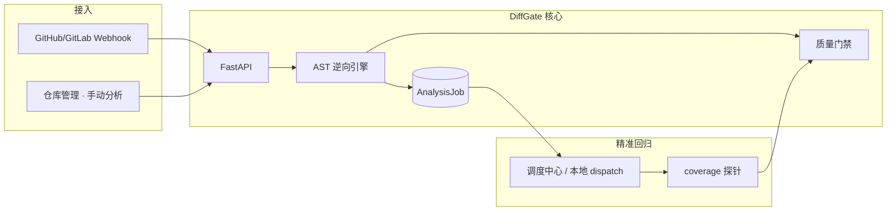

# DiffGate v2.0 产品说明书

> 基于 AST 逆向接口追溯与质量门禁的 Code Change Intelligence 平台。  
> 适用读者：研发负责人、测试/质量工程师、平台运维、CI 集成开发。  
> 文档版本：与仓库 `main` 同步（2026-11）。

---

## 1. 产品定位

DiffGate 在代码 **Push / MR** 后自动完成：

1. **变更定位**：`git diff` 提取变更行与符号；
2. **影响分析**：Python AST 构建调用图，反向追溯到 **FastAPI 等 Web API**；
3. **精准回归**：按影响面收敛待测接口与 YAML 用例集合；
4. **探针覆盖率**：测试环境执行冒烟 + `coverage` 统计 **增量行覆盖率**；
5. **质量门禁**：综合覆盖率阈值、接口回归等输出 **PASS / BLOCK / PENDING**，并支持 **人工豁免** 审计。

**默认行为说明**：门禁「已拦截」是平台内裁决，**不会自动拦截 Git Push**；若要在 CI 中 fail job，需自行对接 `gate-report` 或状态检查 API。

---

## 2. 系统架构（逻辑）



- **单进程开发**：`USE_BACKGROUND_TASKS=true` 时，分析在 API 进程后台执行，无需 Celery Worker。  
- **可选组件**：Redis/Celery 队列、Neo4j 图库持久化、MySQL（生产）或 SQLite（本地 `data/diffgate.db`）。

---

## 3. Web 功能模块

| 导航 | 路径 | 功能摘要 |
|------|------|----------|
| 质量驾驶舱 | `/dashboard` | 覆盖率趋势、门禁流水、拦截原因分布、最近门禁动态 |
| 变更影响 | `/analysis` | 分析任务列表，进入作业详情（拓扑图、嫌疑函数、Diff） |
| 精准回归 | `/regression` | 回归批次、用例结果、增量覆盖率探针、人工豁免 |
| 仓库管理 | `/repositories` | 接入仓库、AST 索引、Webhook、触发分析、门禁阈值 |
| 作业详情 | `/jobs/:id` | 调用链 G6 拓扑、变更函数表、代码抽屉、跳转精准回归 |

### 3.1 质量驾驶舱

- **KPI**：平均增量覆盖率、首次通过率、拦截次数、趋势对比等（数据来自真实 `AnalysisJob.gate_result`）。  
- **趋势图**：变更行数柱 + 增量覆盖率折线（无覆盖率回传的日期为断点，不伪造 80%）。  
- **最近质量门禁动态**：每条显示仓库、Commit、变更规模、覆盖率、状态（通过 / 待处理 / 已拦截 / 人工豁免）。  
- **拦截原因分布**：仅统计 `BLOCK` 批次的原因标签（如「增量覆盖率不足」）。

### 3.2 变更影响（分析任务）

- 创建方式：Webhook 自动、仓库页「触发分析」、本地 `scripts/analyze_local.py`。  
- **作业详情**能力：  
  - **影响拓扑图**（AntV G6）：支持按文件聚合、悬停高亮路径、点击查看代码片段；  
  - **变更函数明细**：搜索、过滤、列合并、查看 Diff；  
  - **层数（调用深度）**：基于 BFS 父链计算，无完整链时显示 `—`；  
  - **Code Diff 抽屉**：高亮变更行与风险调用点。  
- 分析完成后推送 **调度中心**（若配置 `DISPATCH_CENTER_URL`），并写入初始 `gate_result`（无覆盖率时常为 **PENDING**）。

### 3.3 精准回归

- **左栏 · 回归执行批次**：仓库名 + 分支标签、Commit、时间、API 数、覆盖率%、门禁徽标（含 **豁免**）。  
- **右栏 · 批次执行详情**：  
  - **受影响 API 用例**：模拟/冒烟对应的 YAML 行，断言摘要，展开 **请求/响应** 报文；  
  - **增量覆盖率**：变更行探针列表（绿/红/灰），汇总百分比。  
- **KPI 四卡**：累计精准用例、通过率、探针覆盖率、当前门禁（随选中批次联动）。  
- **`BLOCK` 时**：可点击 **人工豁免放行**（见第 5 节）。

### 3.4 仓库管理

- 配置：`clone_url`、`scan_root`、认证方式（无/token/ssh）、**增量覆盖率阈值（默认 80%）**、Webhook 开关。  
- **AST 全量索引 / 重建索引**：更新 `last_indexed_at`（UTC 存储，界面显示本地时间）。  
- **触发分析**：对当前 `default_branch` 与 `HEAD` 创建 `AnalysisJob`。  
- **统计卡**：已接入仓库数、分析次数、高危拦截估算、回归省时比例等。

---

## 4. 端到端业务流程

```text
1. 研发 Push / MR
      ↓
2. Webhook → 创建 AnalysisJob → AST 分析（status: completed/failed）
      ↓
3. 写入 affected_apis、changed_symbols、gate_result（常 PENDING）
      ↓
4. notify_dispatch_center（可选）
      ↓
5. POST /api/v1/dispatch/regression（本地测试）或外部 CI
      → coverage 探针 → POST /api/v1/jobs/{id}/gate-report
      ↓
6. 更新 incremental_coverage_pct、coverage_probes → 门禁 PASS/BLOCK
      ↓
7. 驾驶舱 / 精准回归展示；必要时人工豁免 → OVERRIDDEN
```

### 4.1 本地探针（测试环境）

在 `.env` 中配置：

```env
DISPATCH_CENTER_URL=http://127.0.0.1:8000/api/v1/dispatch/regression
API_PUBLIC_BASE_URL=http://127.0.0.1:8000
```

分析完成后自动进入本地调度；也可手动：

```powershell
$env:PYTHONPATH="."
.\.venv\Scripts\python.exe scripts\coverage.py --job-id <AnalysisJob UUID>
```

或：`POST /api/v1/regression/batches/{job_id}/run-coverage`

---

## 5. 质量门禁规则

门禁结果保存在 `analysis_jobs.gate_result`（JSON）。

| 状态 | 含义 | 典型条件 |
|------|------|----------|
| **PENDING** | 待裁决 | 有影响面但尚未回传覆盖率 |
| **PASS** | 放行 | 覆盖率 ≥ 仓库阈值，且规则未触发拦截 |
| **BLOCK** | 拦截 | 见下表 `block_reason` |
| **OVERRIDDEN** | 人工豁免 | 原 BLOCK 经特批，保留审计字段 |

| block_reason | 展示文案 | 说明 |
|----------------|----------|------|
| incremental_coverage_low | 增量覆盖率不足 | 回传 % < `coverage_threshold` |
| core_api_regression | 核心接口回归失败 | `tests_passed=false` 且有 API 影响 |
| analysis_failed | 分析任务失败 | `job.status=failed` |
| high_risk_unreviewed | 高危模块未评审 | API/符号数超平台阈值 |
| pending_coverage | 待覆盖率回传 | 仅 PENDING 态说明用 |

**零影响变更**：无 API/符号/嫌疑时自动 **PASS**（`coverage_source: auto_zero_impact`）。

### 5.1 人工豁免（Manual Override）

- **入口**：精准回归详情，`BLOCK` 时显示「人工豁免放行」。  
- **必填**：原因分类（Hotfix / 无法模拟分支 / 已评审非核心 / 其他）+ 说明（≥2 字）+ 操作人。  
- **结果**：`gate=OVERRIDDEN`，徽标 **PASS（人工豁免）**，详情顶栏展示审计句；驾驶舱计为「通过」类统计，流水显示「人工豁免」。  
- **保护**：已豁免批次在再次跑 coverage 时 **不会自动改回 BLOCK**（审计锁定）。  
- **API**：`POST /api/v1/regression/batches/{job_id}/override`

---

## 6. 探针增量覆盖率

- **计算**：对变更 `line_ranges` 与冒烟执行行命中求交，得到 `incremental_coverage_pct` 与 `coverage_probes[]`。  
- **展示**：精准回归第 3 KPI、左栏批次第二行、详情「增量覆盖率」Tab。  
- **与用例关系**：覆盖率 BLOCK **不**代表某条 API 用例 FAIL；用例状态以冒烟/模拟结果为准。

---

## 7. 主要 HTTP API（速查）

前缀：`/api/v1`

| 模块 | 方法 | 路径 | 说明 |
|------|------|------|------|
| Webhook | POST | `/webhooks/github` `/webhooks/gitlab` | 接收 Push/MR |
| 作业 | GET | `/jobs` `/jobs/{id}` | 列表与详情 |
| 作业 | GET | `/jobs/{id}/graph` | G6 拓扑数据 |
| 作业 | GET | `/jobs/{id}/code-diff` | 代码片段 |
| 作业 | POST | `/jobs/{id}/gate-report` | CI 回传覆盖率与测试结果 |
| 驾驶舱 | GET | `/dashboard/overview` | KPI + 趋势 + 流水 |
| 回归 | GET | `/regression/overview` `/batches` `/batches/{id}` | 精准回归聚合 |
| 回归 | POST | `/regression/batches/{id}/override` | 人工豁免 |
| 回归 | POST | `/regression/batches/{id}/run-coverage` | 重跑探针 |
| 调度 | POST | `/dispatch/regression` | 本地/测试调度入口 |
| 仓库 | CRUD | `/repositories` | 仓库与索引、触发分析 |
| 系统 | GET | `/system/status` | 健康与依赖 |

### gate-report 请求体示例

```json
{
  "incremental_coverage_pct": 88.6,
  "tests_passed": true,
  "coverage_probes": [
    { "file": "app/main.py", "line": 42, "covered": true, "prefix": "+" }
  ]
}
```

---

## 8. 部署与运维

| 脚本 | 用途 |
|------|------|
| `scripts/run_api.ps1` | 启动 API（8000） |
| `scripts/run_web.ps1` | 启动前端 Vite（5173） |
| `scripts/run_worker.ps1` | Celery Worker（可选） |
| `scripts/coverage.py` | 手动探针 + 写门禁 |
| `scripts/analyze_local.py` | 无 Webhook 本地分析 |

**注意**：

- 修改后端后需 **重启 API**；仅前端改动可热更新。  
- 勿将 `.env`、私钥提交至 Git。  
- `最近索引` 时间为 **AST 全量索引** 完成时刻，不是每次 Diff 分析时间。

---

## 9. 与 CI/CD 对接建议

1. 分析仍由 Webhook 或仓库触发，产物为 `job_id`。  
2. 测试流水线执行受影响用例 + `coverage.py`（或自研脚本）。  
3. 调用 `POST .../jobs/{job_id}/gate-report`。  
4. 若 `gate_result.gate == "BLOCK"` 且未豁免，则 **exit 1** 失败流水线（需自行实现）。  
5. 紧急发版走 DiffGate **人工豁免**，保留审计后再合并。

---

## 10. 常见问题（FAQ）

**Q：已拦截是否会让 `git push` 失败？**  
A：不会。仅当 CI 读取门禁并主动 fail job 时才会阻断发布。

**Q：门禁 BLOCK 但 8/8 用例 PASS？**  
A：多为 **覆盖率不足**（如 75.1% &lt; 80%），与用例绿灯不矛盾。

**Q：左栏覆盖率显示 `—`？**  
A：该批次尚未回传探针，状态常为 PENDING；配置 `DISPATCH_CENTER_URL` 或运行 `scripts/coverage.py`。

**Q：确认豁免按钮无反应？**  
A：确认 API 已重启且存在 `/regression/batches/{id}/override`；说明至少 2 个字；仅 **BLOCK** 可豁免。

**Q：时间显示偏差 8 小时？**  
A：请使用最新后端（`as_utc_iso`）+ 前端 `formatLocalDateTime`；硬刷新仓库列表。

---

## 11. 术语表

| 术语 | 含义 |
|------|------|
| AnalysisJob | 单次 Diff+AST 分析任务 |
| gate_result | 门禁 JSON（覆盖率、原因、探针、豁免） |
| 精准回归 | 基于影响 API 收敛的用例与覆盖率批次 |
| 探针行 | 变更 diff 中每一行的覆盖命中占位 |
| scan_root | 仓库内 Python 扫描根目录（如 `backend`） |

---

## 12. 相关文档

- [README.md](../README.md) — 安装与快速开始  
- [docs/AST_REVERSE_TRACE.md](./AST_REVERSE_TRACE.md) — 四步 AST 引擎  
- [docs/WEBHOOK_NGROK.md](./WEBHOOK_NGROK.md) — 本机 Webhook 穿透  
- [web/README.md](../web/README.md) — 前端技术说明  

---

*DiffGate — 让每一次变更可见、可测、可门禁。*